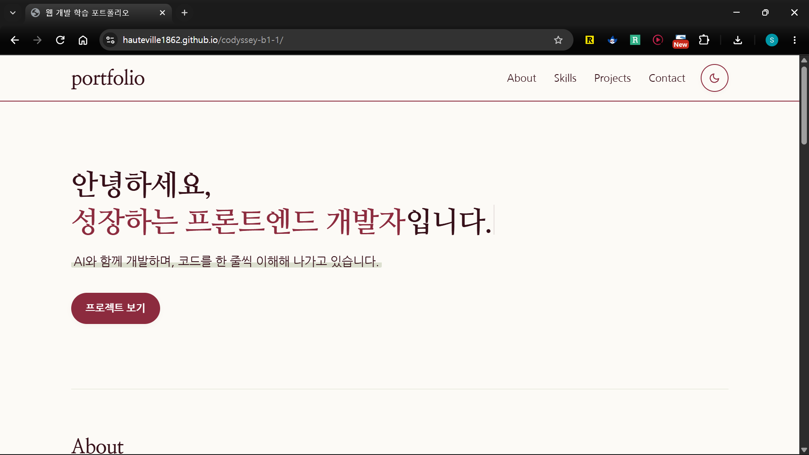
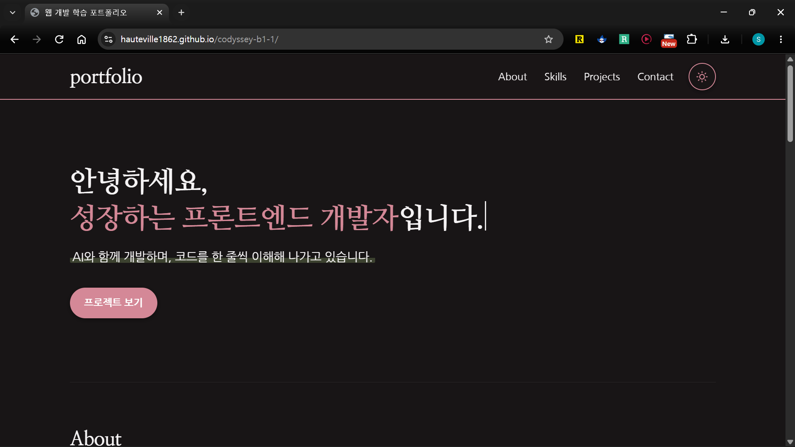
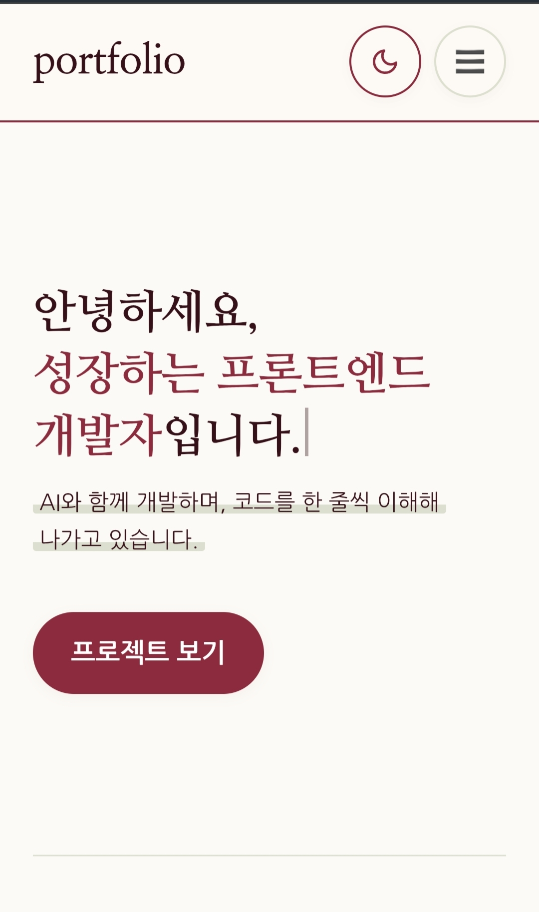
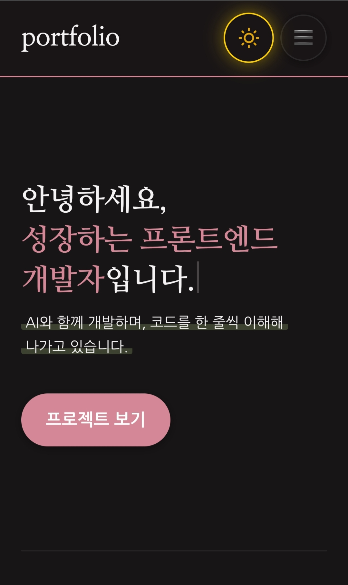

# Yuhyun Lim | 포트폴리오

테마 전환과 GitHub 저장소 조회를 제공하는 반응형 자기소개 웹사이트입니다.

## 사용 기술

HTML5, CSS3, JavaScript (ES6+), GitHub REST API, Google Fonts, GitHub Pages

## 링크

- [배포 사이트](https://hauteville1862.github.io/yuhyun-lim/)

## 스크린샷

기존 스크린샷이며, 최신 화면으로 갱신하기 전의 기록입니다.

| 화면 | 라이트 모드 | 다크 모드 |
| --- | --- | --- |
| 데스크톱 |  |  |
| 모바일 |  |  |
